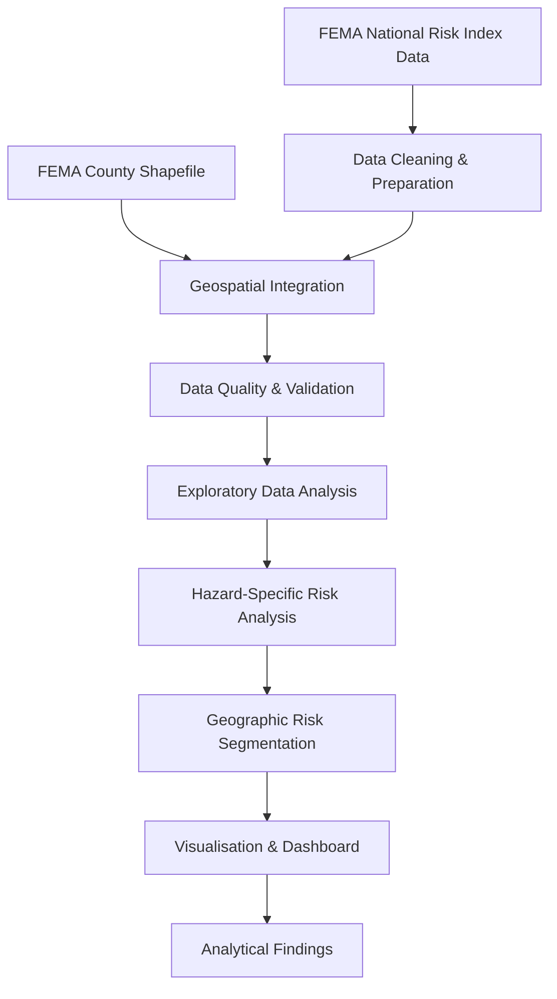
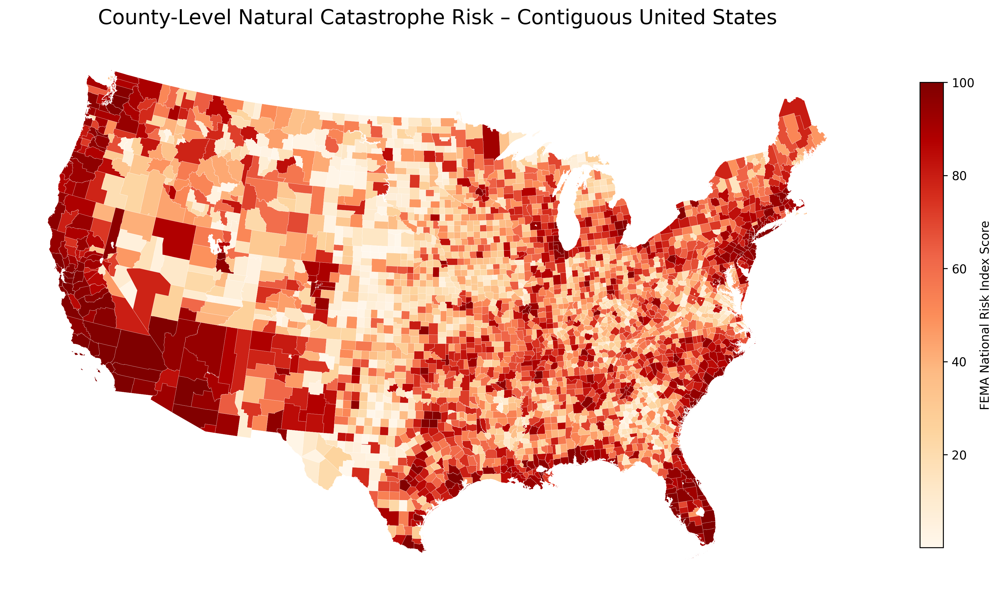
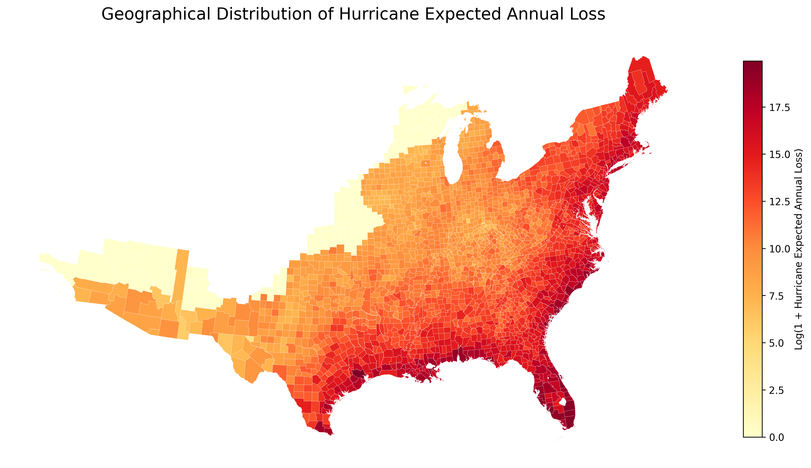
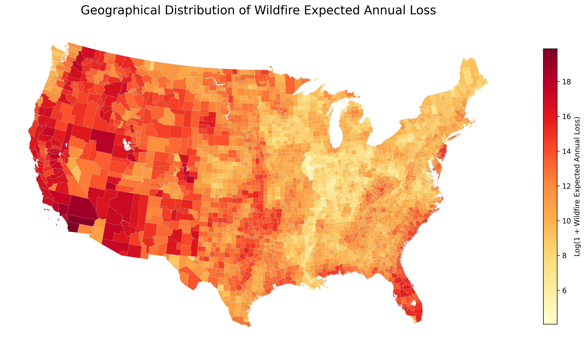
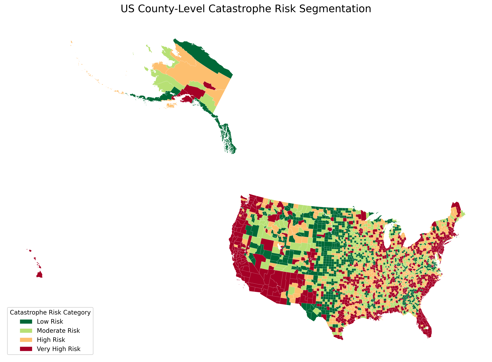
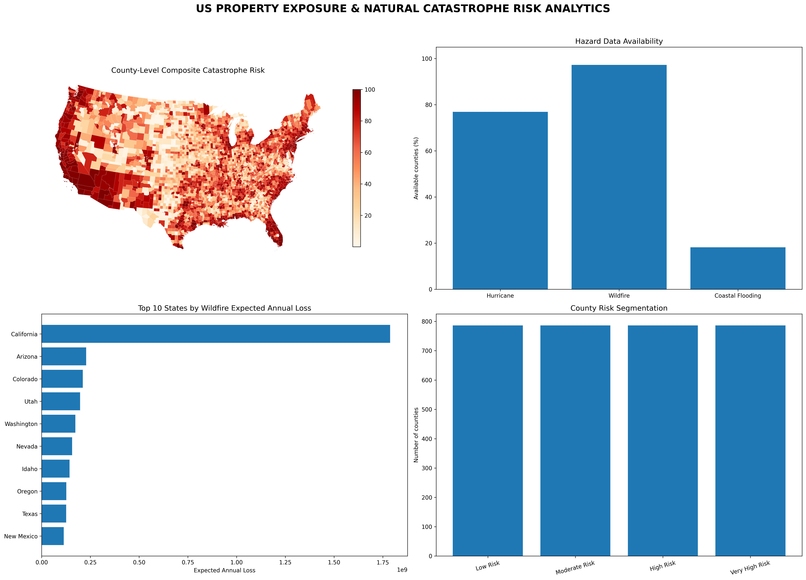

# US Property Exposure & Natural Catastrophe Risk Analytics
### County-Level Assessment of Property Vulnerability to Natural Catastrophes

<p align="center">
  
  
  
  
  
</p>

<p align="center">
  <b>Exploring property exposure, expected annual losses and natural catastrophe risk across US counties.</b>
</p>

---

## 📌 Project Navigation

- [Overview](#-project-overview)
- [Business Objectives](#-business-objectives)
- [Data Sources](#-data-sources)
- [Technology Stack](#-technology-stack)
- [Methodology](#-methodology)
- [Data Quality & Validation](#-data-quality--validation)
- [Key Analysis & Visualisations](#-key-analysis--visualisations)
- [Key Insights](#-key-analytical-considerations)
- [Limitations](#-limitations)
- [Future Enhancements](#-future-enhancements)
- [Repository Structure](#-repository-structure)
- [Disclaimer](#-disclaimer--data-attribution)

---

## 🌎 Project Overview

Natural catastrophes can create significant financial exposure for property insurers. Understanding where property value is concentrated, how expected losses vary geographically, and which hazards contribute to risk is important for exposure monitoring and risk assessment.

This project develops a county-level analytical framework for assessing US property exposure and natural catastrophe risk using the **FEMA National Risk Index (NRI)** dataset.

The analysis combines county-level risk indicators with geographical boundary data to explore:

- Property and population exposure.
- Expected Annual Loss (EAL).
- Hurricane, wildfire and coastal flooding risk.
- Geographic concentration of expected losses.
- County-level risk segmentation.
- Data completeness and geospatial data quality.

**Scope:** This is an exploratory risk analytics project using existing FEMA modelled indicators. It is not an independently developed catastrophe loss prediction or insurance pricing model.

## 🎯 Business Objectives

| Objective | Analytical Approach |
|---|---|
| Understand property exposure | Analyse population and building value across counties |
| Assess catastrophe risk | Examine composite risk and Expected Annual Loss |
| Compare hazard exposure | Analyse hurricane, wildfire and coastal flooding indicators |
| Identify geographic concentrations | Aggregate risk and EAL at state and county levels |
| Assess loss intensity | Compare EAL against building value |
| Ensure data reliability | Perform missing-value, duplicate, merge and geometry checks |

## 📂 Data Sources

### 1. FEMA National Risk Index

**Dataset:** FEMA National Risk Index — December 2025, Version 1.20.0.

The dataset provides county-level information on:

- Expected Annual Loss (EAL)
- Risk scores and ratings
- Social Vulnerability
- Community Resilience
- Hazard-specific exposure and loss indicators

### 2. FEMA County Shapefile

County boundary data was integrated with the risk dataset using the five-digit county FIPS identifier (`STCOFIPS`).

This enabled geographical analysis and county-level risk mapping.

> Note: FEMA's National Risk Index is designed for broad geographic comparisons and planning. Its indicators should not be treated as a substitute for detailed local catastrophe assessment.

## 🛠 Technology Stack

| Tool | Application |
|---|---|
| Python | Data analysis and processing |
| Pandas | Data cleaning and aggregation |
| NumPy | Numerical operations |
| Matplotlib | Data visualisation |
| GeoPandas | Geospatial processing |
| Google Colab | Notebook environment |
| FEMA NRI | Natural catastrophe risk data |

## ⚙️ Methodology

The project follows a structured analytical workflow:



### 1. Data Preparation
- Imported FEMA county-level risk data.
- Selected relevant exposure, risk and EAL variables.
- Standardised county FIPS identifiers.
- Examined missing values and duplicate records.

### 2. Geospatial Integration
- Imported FEMA county boundary shapefile.
- Merged geographical boundaries with county-level risk data.
- Validated the county-level join using FIPS identifiers.
- Repaired invalid geometries.

### 3. Exploratory Data Analysis
- Examined distributions of population, building value and EAL.
- Identified counties with high composite risk scores.
- Compared expected losses across states.
- Examined relationships between exposure and risk indicators using Pearson and Spearman correlations.

### 4. Hazard-Specific Risk Analysis

The analysis focused on three natural hazards:

- **Hurricane:** Examined county-level hurricane expected annual losses.
- **Wildfire:** Analysed wildfire exposure and expected annual losses.
- **Coastal Flooding:** Examined available coastal flooding EAL indicators.

### 5. Geographic Risk Segmentation

Counties were classified into four project-defined categories using quartiles of the available FEMA risk scores:

- Low Risk
- Moderate Risk
- High Risk
- Very High Risk

These categories represent relative segmentation within this project, not official FEMA risk ratings.

---

## ✅ Data Quality & Validation

Data validation was performed before conducting the geographical and risk analysis.

| Validation Check | Result |
|---|---:|
| Total county records | 3,232 |
| Unique county FIPS identifiers | 3,232 |
| Duplicate FIPS identifiers | 0 |
| Unmatched geographical records | 0 |
| Invalid geometries after repair | 0 |
| Counties with available risk scores | 3,144 |

### Hazard Data Availability

| Hazard | Available Counties | Availability |
|---|---:|---:|
| Hurricane EAL | 2,485 | 76.89% |
| Wildfire EAL | 3,144 | 97.28% |
| Coastal Flooding EAL | 588 | 18.19% |

**Important data treatment:** Missing EAL observations were not automatically replaced with zero. Hazard-specific comparisons were restricted to counties with available observations for the relevant variables.

---

## 📊 Key Analysis & Visualisations

### 1. Overall County-Level Risk

Explore the geographical distribution of composite risk scores across US counties.



### 2. Hurricane Expected Annual Loss



### 3. Wildfire Expected Annual Loss



### 4. County Risk Segmentation



### 5. Analytical Dashboard

The dashboard brings together the overall risk map, hazard data availability, state-level wildfire EAL comparison and county risk segmentation.



### Additional Analytical Outputs

- Top 20 counties by hazard-specific Expected Annual Loss.
- State-level expected loss rankings.
- Geographic concentration of expected losses.
- EAL-to-building-value ratios.
- Correlation analysis of exposure and risk indicators.
- Final data quality validation report.

---

## 🔍 Key Analytical Considerations

The analysis highlights several important considerations for property catastrophe risk analytics:

1. **Exposure concentration:** Building value and population are strongly correlated across counties.
2. **Loss concentration:** County and state-level EAL rankings help identify geographic concentrations of modelled losses.
3. **Hazard-specific coverage:** Data availability differs considerably across hazards, particularly coastal flooding.
4. **Risk indicator relationships:** Composite risk and EAL indicators can be closely related because they are components of the same underlying risk framework.
5. **Data quality matters:** Missing observations, geographic matching and geometry validity must be assessed before drawing conclusions.

These are analytical considerations rather than claims of causal relationships.

## ⚠️ Limitations

- FEMA NRI indicators are intended for broad geographic comparisons, not property-level underwriting decisions.
- Coastal flooding EAL is available for only a subset of counties.
- Missing hazard observations may affect comparisons and rankings.
- Quartile-based county categories are project-defined.
- FEMA modelled EAL should not be interpreted as actual insurance claims or realised losses.
- This project does not independently estimate catastrophe probabilities, insurance premiums or policy-level losses.

## 🚀 Future Enhancements

Potential extensions include:

- Integrating historical catastrophe events from NOAA.
- Incorporating Census ACS housing and demographic indicators.
- Exploring more granular property exposure data.
- Developing interactive geospatial dashboards.
- Conducting portfolio-level catastrophe stress testing.
- Automating recurring data quality and exposure monitoring.

These are proposed enhancements and are not part of the current completed analysis.

## 📁 Repository Structure

```text
us-property-catastrophe-risk-analytics/
│
├── data/
│   ├── property_risk_clean.csv
│   └── final_data_quality_report.csv
│
├── notebooks/
│   └── US_Property_Catastrophe_Risk_Analytics.ipynb
│
├── visualisations/
│   ├── us_county_risk_map.png
│   ├── hurricane_eal_map.png
│   ├── wildfire_eal_map.png
│   ├── us_risk_segmentation_map.png
│   └── catastrophe_risk_dashboard.png
│
├── README.md
└── requirements.txt
```

## 📖 How to Explore the Project

1. Open the `notebooks` folder.
2. Access `US_Property_Catastrophe_Risk_Analytics.ipynb`.
3. Review the data preparation and validation steps.
4. Explore the EDA and hazard-specific analysis.
5. View the maps and dashboard in the `visualisations` folder.

---

## 📜 Disclaimer & Data Attribution

This project uses the Federal Emergency Management Agency's (FEMA) National Risk Index dataset, Version 1.20.0, December 2025.

**FEMA attribution disclaimer:**

"This product uses the Federal Emergency Management Agency's National Risk Index dataset API or downloadable datasets but is not endorsed by FEMA. The Federal Government or FEMA cannot vouch for the data or analyses derived from these data after the data have been retrieved from the Agency's website(s)."

The project is independently developed for educational and analytical purposes. It is not an official FEMA product and should not be used as a substitute for professional catastrophe modelling, underwriting or insurance risk assessment.

---

<p align="center">
  <b>Built as a practical exploration of property exposure, catastrophe risk and geospatial analytics.</b>
</p>
